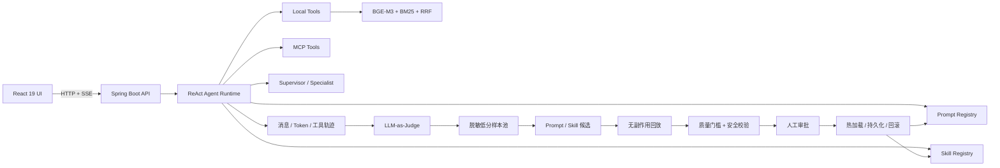

# HelloAgent

> 基于 Spring Boot、Spring AI 与 React 19 构建的可控、可观测、可演化智能体平台。

HelloAgent 不只是对话接口封装。项目实现了受状态机与最大步数约束的 ReAct 运行时，并将 RAG、MCP、Multi-Agent、Skills 渐进式披露、SSE 流式交互、工具安全、LLM-as-Judge 和受控 Auto-Evolution 串成完整工程闭环。

## 核心能力

- **Agent 运行时**：模型思考、工具调用、结果回填与终止均由状态机管理，支持最大步数保护和会话记忆。
- **统一工具体系**：本地 Spring AI Tool 与 MCP ToolCallback 使用同一执行入口；当前接入 AnySearch MCP 的 4 个工具。
- **Skills 渐进式披露**：系统提示词只常驻 Skill 名称和摘要，模型需要时再通过 `useSkill` 加载完整 `SKILL.md`，降低无效上下文消耗。
- **混合 RAG**：BGE-M3 向量召回与 BM25 关键词召回通过 RRF 融合，并提供 HitRate、Recall、MRR、nDCG 评测。
- **Multi-Agent**：Supervisor 按任务委派 Specialist，Worker 使用独立提示词、上下文和工具集合完成垂直任务。
- **流式与可观测性**：基于 SSE 推送模型分片、工具状态和异步评分，记录 Token、模型、finish reason 与执行轨迹。
- **安全边界**：Prompt Injection/PII Guardrails，数据库只读约束，文件系统沙箱，邮件白名单、限流和审计。
- **受控 Auto-Evolution**：自动挖掘低分轨迹并生成 Prompt/Skill 候选，经无副作用回放、质量与安全门禁、人工审批后热加载，支持持久化恢复和回滚。

## 系统架构



## 受控 Auto-Evolution

演化流程不是让模型直接修改线上配置，而是 Human-in-the-loop 的受控状态机：

```text
DRAFT → EVALUATING → EVALUATED → APPROVED → ACTIVE
旧 ACTIVE → SUPERSEDED；当前 ACTIVE 回滚后 → ROLLED_BACK，并恢复上一候选为 ACTIVE
```

1. Assistant 消息完成后，`AgentEvalService` 异步执行 correctness、completeness、relevance 三维评分。
2. `EvolutionTraceService` 聚合问题、回答、Prompt 版本、工具、Skill、Token 和评分，脱敏后持久化轨迹。
3. `EvolutionCandidateService` 从低分样本生成版本化 Prompt/Skill 候选，但不直接生效。
4. `LlmEvolutionReplayEvaluator` 在不挂载真实工具的条件下回放历史问题，避免数据库、邮件和文件副作用。
5. `EvolutionWorkflowService` 执行安全校验与质量门槛校验；默认候选均分至少 3.2，且相对基线提升至少 0.2。
6. 通过人工审批后，`EvolutionArtifactManager` 热加载活动版本并原子持久化；连续发布会保存 `previousCandidateId + previousContent`，旧活动版本转为 `SUPERSEDED`，回滚时逐级恢复。

> 当前回放主要验证回答质量，不代表已完整覆盖工具选择质量；生产环境可进一步接入 Mock Tool、录制回放、灰度流量和线上自动回滚。

## 关键源码导航

| 能力 | 实现入口 |
| --- | --- |
| ReAct 主循环 | [`ShopAi.run/step/think/execute`](ShopAssistant/src/main/java/com/xmu/ShopAssistant/agent/ShopAi.java) |
| Agent 组装、MCP 合并 | [`ShopAiFactory`](ShopAssistant/src/main/java/com/xmu/ShopAssistant/agent/ShopAiFactory.java) |
| Skills 注册与目录披露 | [`SkillRegistry`](ShopAssistant/src/main/java/com/xmu/ShopAssistant/skill/SkillRegistry.java) |
| Skill 按需加载 | [`UseSkillTool.useSkill`](ShopAssistant/src/main/java/com/xmu/ShopAssistant/agent/tools/UseSkillTool.java) |
| 混合检索与 RRF | [`RagServiceImpl`](ShopAssistant/src/main/java/com/xmu/ShopAssistant/service/impl/RagServiceImpl.java) |
| Supervisor/Worker | [`DelegateToSpecialistTool`](ShopAssistant/src/main/java/com/xmu/ShopAssistant/agent/multi/DelegateToSpecialistTool.java)、[`SpecialistRunner`](ShopAssistant/src/main/java/com/xmu/ShopAssistant/service/SpecialistRunner.java) |
| SSE 连接与心跳 | [`SseServiceImpl`](ShopAssistant/src/main/java/com/xmu/ShopAssistant/service/impl/SseServiceImpl.java) |
| 输入输出 Guardrails | [`GuardrailsService`](ShopAssistant/src/main/java/com/xmu/ShopAssistant/guardrails/GuardrailsService.java) |
| 工具限流与审计 | [`ToolGuard`](ShopAssistant/src/main/java/com/xmu/ShopAssistant/agent/tools/security/ToolGuard.java) |
| LLM-as-Judge | [`AgentEvalService`](ShopAssistant/src/main/java/com/xmu/ShopAssistant/eval/AgentEvalService.java) |
| 演化闭环 API | [`EvolutionController`](ShopAssistant/src/main/java/com/xmu/ShopAssistant/controller/EvolutionController.java) |
| 候选工作流与回滚 | [`EvolutionWorkflowService`](ShopAssistant/src/main/java/com/xmu/ShopAssistant/evolution/EvolutionWorkflowService.java) |

## 技术栈

- 后端：Java 17、Spring Boot、Spring AI、MyBatis、PostgreSQL
- 模型：DeepSeek（默认），可选智谱模型
- Agent：ReAct、Spring AI Tool Calling、MCP Client、Multi-Agent
- RAG：BGE-M3、BM25、RRF
- 前端：React 19、TypeScript、Vite、Ant Design X、Tailwind CSS
- 工程能力：SSE、LLM-as-Judge、Guardrails、Auto-Evolution、JUnit

## 项目结构

```text
HelloAgent/
├── ShopAssistant/                   # Spring Boot 后端
│   ├── src/main/java/.../
│   │   ├── agent/                   # ReAct、工具、Multi-Agent
│   │   ├── controller/              # HTTP 与演化接口
│   │   ├── eval/                    # LLM-as-Judge
│   │   ├── evolution/               # 轨迹、候选、回放、发布与回滚
│   │   ├── guardrails/              # 输入拦截与输出脱敏
│   │   ├── prompt/                  # Prompt 注册与活动覆盖层
│   │   ├── skill/                   # Skill 解析、注册与热加载
│   │   └── service/                 # RAG、SSE、业务服务
│   └── src/test/                    # 单元测试与集成测试
├── ui/                              # React 19 前端
├── data/skills/                     # SKILL.md 运行目录
└── CHANGELOG-2026-08.md             # 最新功能变更记录
```

## 本地启动

### 1. 环境要求

- JDK 17+
- Maven 3.9+
- Node.js 18+（前端及 MCP 的 `npx` 代理需要）
- PostgreSQL

### 2. 配置凭据

所有密钥均通过环境变量注入，不要写入 `application.yaml` 或提交到 Git。PowerShell 示例：

```powershell
$env:DEEPSEEK_API_KEY="你的 DeepSeek API Key"
$env:DB_URL="jdbc:postgresql://localhost:5432/jchatmind"
$env:DB_USERNAME="postgres"
$env:DB_PASSWORD="你的数据库密码"
```

可选变量包括 `ZHIPUAI_API_KEY`、`MAIL_USERNAME`、`MAIL_PASSWORD`、`ANYSEARCH_API_KEY`、`AGENT_SKILLS_DIR` 和 `AGENT_EVOLUTION_DIR`。

### 3. 启动后端

```powershell
cd ShopAssistant
mvn spring-boot:run
```

Windows 默认通过 `npx.cmd -y mcp-remote https://api.anysearch.com/mcp` 拉起 AnySearch MCP 代理；Linux/macOS 请将 `application.yaml` 中的命令调整为 `npx`。

### 4. 启动前端

```powershell
cd ui
npm install
npm run dev
```

前端开发地址默认为 `http://localhost:5173`，后端健康检查为 `http://localhost:8080/health`。

## 主要接口

| 模块 | 接口 |
| --- | --- |
| Agent | `GET/POST /api/agents` |
| 会话与消息 | `/api/chat-sessions`、`/api/chat-messages` |
| SSE | `GET /sse/connect/{chatSessionId}` |
| 知识库 | `/api/knowledge-bases`、`/api/documents` |
| RAG 评测 | `POST /api/rag/evaluate` |
| Agent 评测 | `POST /eval/agent` |
| 低分轨迹 | `GET /api/evolution/traces?lowScoreOnly=true` |
| 候选生成 | `POST /api/evolution/candidates/generate` |
| 候选流转 | `POST /api/evolution/candidates/{id}/{evaluate\|approve\|activate\|rollback}` |

## 测试与验证

```powershell
cd ShopAssistant
mvn test

cd ../ui
npm run lint
npm run build
```

当前完整回归包含 18 项后端测试，覆盖基础对话、多轮记忆、ReAct 工具调用、MCP 握手、轨迹采集、候选生成、状态流转、重启恢复与回滚；前端 lint/build 和后端 package 已通过。一次隔离 HTTP 链路测试中 Judge 分数由 1.33 提升至 5.00，该数字只用于证明闭环可运行，不作为统计意义上的效果结论。

## 文档

- [2026-08 功能变更记录](CHANGELOG-2026-08.md)
- [早期版本变更记录](CHANGELOG-2026-06.md)

## License

本项目用于个人学习、Agent 工程实践与作品展示。
